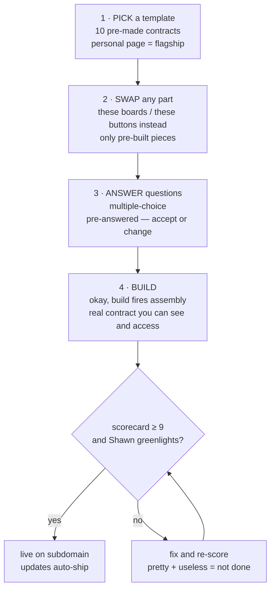
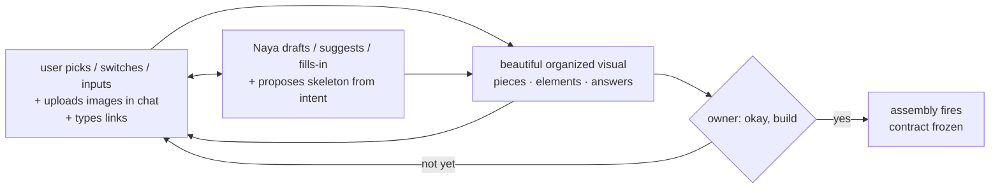
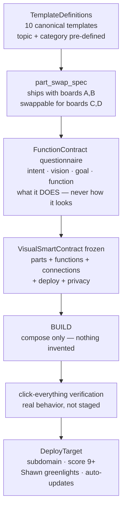
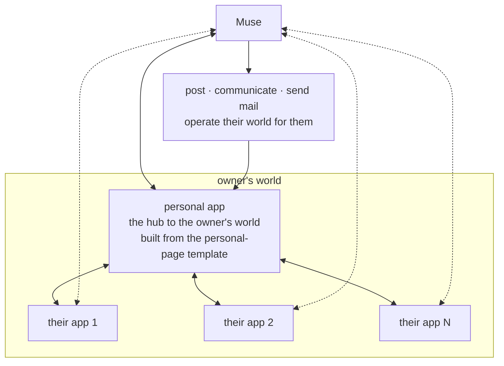

# VISUAL SMART CONTRACT — the official machine version (v1)

**Status:** DRAFT — **NOT RATIFIED.** Ratification is Shawn's protected gate
(memory: standing auto-approval law). Nothing in this file is law until he
stamps it.

**Version:** 1 · **Date:** 2026-10-17 · **Seat:** BUILD/Nu, Team Nitro
(drafter) · **Lineage:** machine rendering of
`team-nitro/smart-builder/CONTRACT-HUMAN-v1.md` (the human version, written
by Naya Nitro Narzan 2026-10-17) plus Shawn's directives from memory.

## Traceability rule (binding)

Every section of this document cites its human source in a `Source:` line.
**If the human contract doesn't say it, it doesn't go in.** The only
exceptions are pure schema mechanics (field types, enums, requiredness)
with no semantic content. Nothing invented. When the human version and this
machine version disagree, the human version wins and this file gets amended.

**Sources key:** `H:<section>` = CONTRACT-HUMAN-v1.md section ·
`M:<topic>` = Shawn directive from memory (Visual Smart Contract 20:09Z;
Naya apps positioning 19:23Z; templates+connected world 19:01Z; vision loop
18:53Z; intake BUILD NOW 18:29Z; function law; deploy doctrine;
compose-don't-create).

---

## 1. Machine-readable schemas

The six canonical schema blocks. Each is valid JSON (validated with
`python3 -c json.loads` before commit). Field names are the canonical
machine vocabulary; the human labels live in `PieceReference`.

### 1a. `VisualSmartContract` — top-level contract

Source: H:"What we're building" + H:"The function contract" + H:"Deploy" +
H:"Private by default" + M:Visual Smart Contract 20:09Z (contract comes
FIRST, complete; every page is an all-in-one snapshot of any topic).

```json
{
  "$schema": "http://json-schema.org/draft-07/schema#",
  "title": "VisualSmartContract",
  "type": "object",
  "required": ["contract_id", "version", "topic", "category", "owner", "intent", "parts", "functions", "privacy", "deploy", "intake"],
  "properties": {
    "contract_id": { "type": "string", "description": "Unique id, e.g. vsc-20261017-001" },
    "version": { "type": "string", "const": "1" },
    "topic": { "type": "string", "description": "What the app is about. The topic starts with the owner: 'this is who I am, this is my world'" },
    "category": { "type": "string", "description": "Pre-defined category from the contract; never invented at build time" },
    "owner": { "type": "string", "description": "The human whose world this app belongs to" },
    "intent": { "type": "string", "description": "What the owner intends — the vision captured in the intake" },
    "template_ref": { "type": ["string", "null"], "description": "TemplateDefinitions id this contract was built from; null for fully custom compose" },
    "parts": {
      "type": "array",
      "description": "Composed pre-built elite pieces. Never invented at build time (compose-don't-create).",
      "items": {
        "type": "object",
        "required": ["piece_ref", "slot"],
        "properties": {
          "piece_ref": { "type": "string", "description": "PieceReference id from the gallery" },
          "slot": { "type": "string", "description": "The part slot this piece fills (hero, feed, form, ...)" },
          "tweak_tokens": { "type": "object", "description": "One-token tweaks only; piece DNA intact", "additionalProperties": { "type": "string" } }
        }
      }
    },
    "functions": {
      "type": "array",
      "description": "FunctionContract entries: what each element DOES",
      "items": {
        "type": "object",
        "required": ["function_id", "does"],
        "properties": {
          "function_id": { "type": "string" },
          "does": { "type": "string", "description": "What it DOES — user states function, never look" },
          "intent": { "type": "string" },
          "goal": { "type": "string" }
        }
      }
    },
    "connections": {
      "type": "array",
      "description": "Connected-world bindings: owner services the page works WITH (Google Drive, etc.)",
      "items": {
        "type": "object",
        "required": ["service", "scope"],
        "properties": {
          "service": { "type": "string", "description": "e.g. google_drive" },
          "scope": { "type": "string", "description": "Owner-scoped connector binding; pointed at the page OWNER's world, not the builder's" }
        }
      }
    },
    "deploy": {
      "type": "object",
      "required": ["subdomain", "score", "shawn_greenlit"],
      "properties": {
        "subdomain": { "type": "string", "description": "Preview subdomain. Never the main page." },
        "score": { "type": "number", "description": "Honest scorecard score; must be >= 9 to go live" },
        "shawn_greenlit": { "type": "boolean", "description": "Shawn has looked at and greenlit the page" },
        "auto_updates": { "type": "boolean", "description": "After first greenlight, updates ship automatically" }
      }
    },
    "privacy": { "type": "string", "enum": ["private", "shared"], "description": "private by default; shared is opt-in only" },
    "intake": { "type": "object", "description": "IntakeFields snapshot frozen at 'okay, build'" }
  }
}
```

### 1b. `IntakeFields` — the living-form intake

Source: H:"How it works — the intake" + H:"Mobile-first" (app icon step) +
M:intake BUILD NOW 18:29Z (images upload in chat and ride the contract;
links become contract fields; living form co-crafted by both sides; user
always sees a beautiful organized visual; app icon handled in intake).

```json
{
  "$schema": "http://json-schema.org/draft-07/schema#",
  "title": "IntakeFields",
  "type": "object",
  "description": "The living form: user picks/switches/inputs; Naya drafts/suggests/fills-in. Molded in the open until 'okay, build' fires assembly.",
  "required": ["user_inputs", "naya_drafts", "okay_build_trigger"],
  "properties": {
    "user_inputs": {
      "type": "object",
      "properties": {
        "picked_pieces": { "type": "array", "items": { "type": "string" }, "description": "Piece ids the user picked from the gallery" },
        "switches": { "type": "object", "description": "Toggles the user flipped", "additionalProperties": { "type": "boolean" } },
        "answers": { "type": "object", "description": "Questionnaire answers incl. multiple-choice (pre-answered)", "additionalProperties": { "type": "string" } }
      }
    },
    "naya_drafts": {
      "type": "object",
      "properties": {
        "suggestions": { "type": "array", "items": { "type": "string" }, "description": "Naya's drafts/suggestions the user can accept, edit, or reject" },
        "filled_in": { "type": "object", "description": "Fields Naya filled in on the user's behalf", "additionalProperties": { "type": "string" } }
      }
    },
    "images_uploaded": {
      "type": "array",
      "description": "Images uploaded right in chat ride the contract into the build — nobody uploads twice.",
      "items": {
        "type": "object",
        "required": ["image_id", "bytes_ref", "used_in_slot"],
        "properties": {
          "image_id": { "type": "string" },
          "bytes_ref": { "type": "string", "description": "Content-addressed reference into the contract payload" },
          "used_in_slot": { "type": "string", "description": "Which part slot consumes the image" }
        }
      }
    },
    "links": {
      "type": "array",
      "description": "Links typed into the builder ('enter your links here') become contract fields.",
      "items": {
        "type": "object",
        "required": ["label", "href"],
        "properties": {
          "label": { "type": "string" },
          "href": { "type": "string", "format": "uri" },
          "slot": { "type": "string", "description": "Which part slot the link binds to" }
        }
      }
    },
    "copy_source": {
      "type": "object",
      "required": ["mode"],
      "properties": {
        "mode": { "type": "string", "enum": ["talk", "paste", "drop_doc"], "description": "Page copy comes from talking, pasting, or dropping a doc — straight into the contract" },
        "text": { "type": "string" }
      }
    },
    "skeleton_proposal": {
      "type": "object",
      "description": "The builder proposes the page skeleton from intent; the user approves or rearranges it.",
      "required": ["proposed_by", "status"],
      "properties": {
        "proposed_by": { "type": "string", "const": "naya" },
        "slots": { "type": "array", "items": { "type": "string" } },
        "status": { "type": "string", "enum": ["proposed", "approved", "rearranged"] }
      }
    },
    "app_icon": {
      "type": "object",
      "description": "Proactive intake step: the app icon is handled here, never as an afterthought.",
      "required": ["mode"],
      "properties": {
        "mode": { "type": "string", "enum": ["uploaded", "naya_generates"], "description": "Upload at the required size, or Naya generates the image for the page" },
        "image_ref": { "type": "string", "description": "Set when mode=uploaded" },
        "naya_generates": { "type": "boolean" }
      }
    },
    "intake_visual_state": {
      "type": "object",
      "description": "The user always sees a beautiful visual of what's going on — pieces, elements, answers, all organized.",
      "required": ["pieces", "elements", "answers"],
      "properties": {
        "pieces": { "type": "array", "items": { "type": "string" } },
        "elements": { "type": "array", "items": { "type": "string" } },
        "answers": { "type": "object", "additionalProperties": { "type": "string" } }
      }
    },
    "okay_build_trigger": {
      "type": "object",
      "description": "'okay, build' fires assembly — the only assembly trigger.",
      "required": ["phrase", "fired"],
      "properties": {
        "phrase": { "type": "string", "const": "okay, build" },
        "fired": { "type": "boolean" }
      }
    }
  }
}
```

### 1c. `FunctionContract` — what everything DOES

Source: H:"The function contract" + M:Visual Smart Contract 20:09Z (the
questionnaire captures intent, vision, goal, function — the part every other
builder skips; division of labor: the user states what it DOES, never what
it looks like; beauty is the system's job).

```json
{
  "$schema": "http://json-schema.org/draft-07/schema#",
  "title": "FunctionContract",
  "type": "object",
  "description": "What everything DOES — intent, vision, goal, function — not how it looks.",
  "required": ["intent", "vision", "goal", "functions"],
  "properties": {
    "intent": { "type": "string", "description": "What the owner intends the app to achieve" },
    "vision": { "type": "string", "description": "The owner's picture of the app succeeding" },
    "goal": { "type": "string", "description": "The measurable outcome the app must produce" },
    "functions": {
      "type": "array",
      "description": "One entry per functional element. The user states what it DOES; the pieces+contract handle how it looks.",
      "items": {
        "type": "object",
        "required": ["function_id", "does"],
        "properties": {
          "function_id": { "type": "string" },
          "does": { "type": "string", "description": "What it DOES (user-authored; never look)" },
          "intent": { "type": "string" },
          "vision": { "type": "string" },
          "goal": { "type": "string" },
          "bound_piece": { "type": ["string", "null"], "description": "PieceReference id realizing it, or null until composed" },
          "default_on": { "type": "boolean", "description": "MUST be true for mail and posting (mandatory per §3.2); false for optional functions", "default": false }
        }
      }
    }
  }
}
```

### 1d. `TemplateDefinitions` — the 10 pre-made contracts

Source: H:"Templates" + M:templates+connected world 19:01Z (pre-made
contracts; pick-a-template → tweak → build; personal page is the flagship;
product pages, NOT full stores; top-10 list) + M:Visual Smart Contract
20:09Z (topic + category pre-defined; multiple-choice questions
pre-answered; click-click-click experience).

The ten templates (ids are canonical; human_label is what humans read;
naya_label is what Nayas use to pull the right contract):

```json
{
  "$schema": "http://json-schema.org/draft-07/schema#",
  "title": "TemplateDefinitions",
  "type": "object",
  "required": ["version", "templates"],
  "properties": {
    "version": { "type": "string", "const": "1" },
    "templates": {
      "type": "array",
      "minItems": 10,
      "maxItems": 10,
      "items": {
        "type": "object",
        "required": ["id", "human_label", "naya_label", "default_parts", "part_swap_spec", "pre_answered_questions", "pre_defined_topic", "pre_defined_category"],
        "properties": {
          "id": { "type": "string" },
          "human_label": { "type": "string", "description": "What humans read in the gallery" },
          "naya_label": { "type": "string", "description": "What Nayas read to pull the right template" },
          "default_parts": { "type": "array", "items": { "type": "string" }, "description": "Piece slots the template ships with" },
          "part_swap_spec": { "type": "array", "description": "Which slots are swappable and for what, e.g. 'ships with boards A,B — swappable for boards C,D'", "items": { "type": "object", "required": ["slot", "ships_with", "swappable_for"], "properties": { "slot": { "type": "string" }, "ships_with": { "type": "array", "items": { "type": "string" } }, "swappable_for": { "type": "array", "items": { "type": "string" } } } } },
          "pre_answered_questions": { "type": "object", "description": "Multiple-choice intake questions with Naya's pre-answers; the user accepts or changes them", "additionalProperties": { "type": "string" } },
          "pre_defined_topic": { "type": "string" },
          "pre_defined_category": { "type": "string" }
        }
      }
    }
  }
}
```

Canonical template registry (data, not schema — validated against the
schema above):

```json
{
  "version": "1",
  "templates": [
    {
      "id": "personal-page",
      "human_label": "Personal Page",
      "naya_label": "naya:template:personal-page:flagship:about-me-social-profiles-linked",
      "default_parts": ["hero_identity", "about_board", "social_links", "feed_snapshot", "contact_action"],
      "part_swap_spec": [{ "slot": "hero_identity", "ships_with": ["hero_identity_v1"], "swappable_for": ["hero_identity_v2", "hero_media"] }, { "slot": "about_board", "ships_with": ["about_board_v1"], "swappable_for": ["about_board_v2", "story_board"] }],
      "pre_answered_questions": { "tone": "warm and confident", "primary_goal": "share my world and invite people to build with me", "privacy": "private until I choose to share" },
      "pre_defined_topic": "The owner: 'this is who I am, this is my world'",
      "pre_defined_category": "personal"
    },
    {
      "id": "business-landing",
      "human_label": "Business Landing",
      "naya_label": "naya:template:business-landing:front-door:what-we-do-contact-hours-action",
      "default_parts": ["hero_value_prop", "services_board", "hours_board", "contact_action", "map_embed"],
      "part_swap_spec": [{ "slot": "services_board", "ships_with": ["services_board_v1"], "swappable_for": ["services_board_v2", "pricing_board"] }],
      "pre_answered_questions": { "tone": "professional and clear", "primary_goal": "turn visitors into contacts", "privacy": "private until I choose to share" },
      "pre_defined_topic": "The business front door",
      "pre_defined_category": "business"
    },
    {
      "id": "booking",
      "human_label": "Booking",
      "naya_label": "naya:template:booking:pick-service:pick-time:done",
      "default_parts": ["service_picker", "time_picker", "confirm_action", "confirmation_board"],
      "part_swap_spec": [{ "slot": "time_picker", "ships_with": ["time_picker_v1"], "swappable_for": ["calendar_embed"] }],
      "pre_answered_questions": { "tone": "simple and fast", "primary_goal": "pick a service, pick a time, done", "privacy": "private until I choose to share" },
      "pre_defined_topic": "Booking a service or session",
      "pre_defined_category": "business"
    },
    {
      "id": "product-page",
      "human_label": "Product Page",
      "naya_label": "naya:template:product-page:single-product:sell-the-thing:NOT-full-store",
      "default_parts": ["product_hero", "gallery_board", "details_board", "price_action", "faq_board"],
      "part_swap_spec": [{ "slot": "gallery_board", "ships_with": ["gallery_board_v1"], "swappable_for": ["gallery_board_v2", "media_reel"] }],
      "pre_answered_questions": { "tone": "desirable and trustworthy", "primary_goal": "sell this one product", "privacy": "private until I choose to share" },
      "pre_defined_topic": "One product, sold beautifully",
      "pre_defined_category": "commerce"
    },
    {
      "id": "portfolio",
      "human_label": "Portfolio",
      "naya_label": "naya:template:portfolio:show-the-work:beautifully",
      "default_parts": ["hero_intro", "work_grid", "project_detail", "contact_action"],
      "part_swap_spec": [{ "slot": "work_grid", "ships_with": ["work_grid_v1"], "swappable_for": ["work_grid_v2", "work_reel"] }],
      "pre_answered_questions": { "tone": "confident and visual", "primary_goal": "show the work beautifully", "privacy": "private until I choose to share" },
      "pre_defined_topic": "The owner's body of work",
      "pre_defined_category": "personal"
    },
    {
      "id": "event",
      "human_label": "Event",
      "naya_label": "naya:template:event:details:countdown:rsvp",
      "default_parts": ["event_hero", "details_board", "countdown_block", "rsvp_form"],
      "part_swap_spec": [{ "slot": "rsvp_form", "ships_with": ["rsvp_form_v1"], "swappable_for": ["signup_form"] }],
      "pre_answered_questions": { "tone": "exciting and clear", "primary_goal": "get the RSVP", "privacy": "private until I choose to share" },
      "pre_defined_topic": "One event",
      "pre_defined_category": "community"
    },
    {
      "id": "menu-price-list",
      "human_label": "Menu / Price List",
      "naya_label": "naya:template:menu-price-list:what-it-costs:what-you-get",
      "default_parts": ["menu_hero", "price_board", "category_tabs", "contact_action"],
      "part_swap_spec": [{ "slot": "price_board", "ships_with": ["price_board_v1"], "swappable_for": ["price_board_v2", "tier_board"] }],
      "pre_answered_questions": { "tone": "clear and appetizing", "primary_goal": "show what it costs and what you get", "privacy": "private until I choose to share" },
      "pre_defined_topic": "The menu or price list",
      "pre_defined_category": "business"
    },
    {
      "id": "community-hub",
      "human_label": "Community Hub",
      "naya_label": "naya:template:community-hub:team:club:cohort:one-place",
      "default_parts": ["hub_hero", "members_board", "activity_feed", "join_action"],
      "part_swap_spec": [{ "slot": "activity_feed", "ships_with": ["activity_feed_v1"], "swappable_for": ["feed_snapshot"] }],
      "pre_answered_questions": { "tone": "welcoming and alive", "primary_goal": "gather the team/club/cohort in one place", "privacy": "private until I choose to share" },
      "pre_defined_topic": "The team, the club, the cohort",
      "pre_defined_category": "community"
    },
    {
      "id": "signup",
      "human_label": "Signup",
      "naya_label": "naya:template:signup:newsletter:waitlist:download:growth-engine",
      "default_parts": ["signup_hero", "value_board", "signup_form", "thank_you_board"],
      "part_swap_spec": [{ "slot": "signup_form", "ships_with": ["signup_form_v1"], "swappable_for": ["signup_form_v2", "waitlist_form"] }],
      "pre_answered_questions": { "tone": "compelling and simple", "primary_goal": "grow the list", "privacy": "private until I choose to share" },
      "pre_defined_topic": "Newsletter, waitlist, or download",
      "pre_defined_category": "growth"
    },
    {
      "id": "dashboard-tracker",
      "human_label": "Dashboard / Tracker",
      "naya_label": "naya:template:dashboard-tracker:live-numbers:alive:not-a-brochure:shows-off-smart",
      "default_parts": ["metrics_hero", "live_numbers_board", "trend_chart", "alert_action"],
      "part_swap_spec": [{ "slot": "live_numbers_board", "ships_with": ["live_numbers_board_v1"], "swappable_for": ["live_numbers_board_v2", "stat_cards"] }],
      "pre_answered_questions": { "tone": "sharp and alive", "primary_goal": "show live numbers, not a brochure", "privacy": "private until I choose to share" },
      "pre_defined_topic": "Live numbers for the owner's world",
      "pre_defined_category": "data"
    }
  ]
}
```

NON-GOAL (carried from the human contract): product-page is NOT a full
store. Full stores are too complex; Shopify sync is future work, not v1.

### 1e. `PieceReference` — dual labels

Source: H:"The gallery" + M:Naya apps positioning 19:23Z (smart builder
gallery has SEARCH with DUAL LABELS: human-readable + Naya-readable, on
every piece) + M:Visual Smart Contract 20:09Z (the builder checks every
element it needs already exists — nothing invented).

```json
{
  "$schema": "http://json-schema.org/draft-07/schema#",
  "title": "PieceReference",
  "type": "object",
  "description": "Dual labels: one humans understand, one Nayas read to pull the right piece.",
  "required": ["piece_id", "human_label", "naya_label", "category", "search_keywords", "works"],
  "properties": {
    "piece_id": { "type": "string" },
    "human_label": { "type": "string", "description": "What a human reads in the gallery" },
    "naya_label": { "type": "string", "description": "What a Naya reads to pull exactly this piece" },
    "category": { "type": "string", "description": "Gallery category: buttons, boards, forms, heros, feeds, ..." },
    "search_keywords": {
      "type": "array",
      "items": { "type": "string" },
      "description": "Gallery search: 'buttons' returns all buttons, 'boards' returns all boards"
    },
    "works": { "type": "boolean", "description": "The piece actually works — real behavior, never staged. Staged pieces never enter the gallery." }
  }
}
```

### 1f. `DeployTarget` — subdomain-first deploy

Source: H:"Deploy" + M:Visual Smart Contract 20:09Z + deploy doctrine
(subdomains; 9+ and his eyes; auto-updates; never overwrite proven) +
M:subdomain law (build on subdomains, never the main page).

```json
{
  "$schema": "http://json-schema.org/draft-07/schema#",
  "title": "DeployTarget",
  "type": "object",
  "description": "Subdomain-first deploy doctrine. The main page is never a build target.",
  "required": ["subdomain", "main_page_protected", "score", "shawn_greenlit", "auto_updates_after_greenlight", "never_overwrite_proven"],
  "properties": {
    "subdomain": { "type": "string", "description": "The preview subdomain the page is built on, e.g. anything.nayanet.live. Always a subdomain, never the main page." },
    "main_page_protected": { "type": "boolean", "const": true, "description": "nayanet.live main stays untouched until a proven page takes it over" },
    "score": { "type": "number", "description": "Honest scorecard score of the working page. Live gate: score >= 9." },
    "shawn_greenlit": { "type": "boolean", "description": "Shawn has looked at the page and greenlit it" },
    "auto_updates_after_greenlight": { "type": "boolean", "description": "After first greenlight, updates ship automatically (his standing deploy word)" },
    "never_overwrite_proven": { "type": "boolean", "const": true, "description": "Never overwrite a proven triple-A page with unproven work" }
  }
}
```

---
## 2. Visual flows

Source: M:Visual Smart Contract 20:09Z (click-click-click: pick a template
→ swap any part → multiple-choice questions pre-answered → build; the
experience must be visual — Shawn's law). Diagrams are mermaid (no HTML,
no interactive examples — kept to markdown+mermaid per L-2026-10-17-004).

### 2a. The click-click-click experience



### 2b. The living-form intake loop (user ⇄ Naya co-crafting)



### 2c. Template → swap → questions → build pipeline



### 2d. The "internet AI net" architecture

Source: M:Visual Smart Contract 20:09Z (AI ↔ personal app ↔ their apps;
Muse ↔ all apps — together the whole world gets automated, shared,
understood: post, communicate, send mail, operate their world for them).



Reading: the personal app is the hub to the owner's world; Muse connects
to ALL apps; together they automate, share, and understand — posting,
communicating, sending mail, operating the owner's world. The built pages
are both the thing built AND how the network grows (§3.11).

---

## 3. Spec sections

Each spec is concise and machine-precise, and cites its human source.

### 3.1 Builder identity: Naya apps, NOT websites

Source: H:"What we're building" + M:Naya apps positioning 19:23Z.

The smart builder builds **Naya apps, not websites**: mini hub portals
that are active, live, smart, and intelligent. Web pages are done; smart
apps are the future. A Naya app is distinguished from a page by behavior:
it interacts (live conversations), it runs functions (mail, posting), and
it stays connected to the owner's world (§3.3). Anything the builder emits
that is not active, live, smart, and intelligent is not a Naya app and does
not ship.

### 3.2 Functions ON by default: mail, posting

Source: M:Visual Smart Contract 20:09Z (functions — mail, posting — ship
ON every page by default; each page is an all-in-one snapshot of any
topic).

Every Naya app carries its functions ON by default: smart mail and posting
are active on every page unless the intake explicitly switches them off.
Machine rule: `FunctionContract.functions[]` MUST include entries for mail
and posting with `default_on: true` before assembly fires. The result is an
all-in-one snapshot of any topic — the owner never assembles functions from
parts; they arrive working.

### 3.3 Connected world: the page works WITH their world

Source: H:"Connected world" + M:templates+connected world 19:01Z
(connections keep the page living; same connector model as Naya's but
pointed at the page owner's world).

Pages stay alive by connecting to the owner's services — Google Drive,
whatever they use. The page works WITH their world, not as a dead
brochure. Machine rule: `VisualSmartContract.connections[]` binds
owner-scoped connectors (same connector model as Naya's, repointed at the
page OWNER's scope). A Naya app with zero connections is a brochure, not a
Naya app — the intake must propose at least one connection from intent.

### 3.4 Naya runs it: interactions, live conversations, mail — automatic

Source: H:"Naya runs it".

Naya can run the owner's page and their business: interactions, live
conversations, mail — all automatic. Machine rule: the built app MUST
expose a Naya-run surface (conversation entry point + mail/posting hooks
from §3.2). "Automatic" means no owner action is required for the app to
respond, converse, and send mail once the contract's functions are bound.

### 3.5 Mobile-first default: installable PWA, icon handled in intake

Source: H:"Mobile-first — the default, not a feature" + M:Naya apps
positioning 19:23Z (every Naya app is born a phone app — mobile-optimized,
installable PWA by default; intake handles the app icon).

Every Naya app is born a phone app: mobile-optimized and installable as a
PWA by default — download it to the phone and it works like an app right
away. Icon, install, mobile presentation and function are common practice,
handled by default. Machine rule: the intake MUST include the
`app_icon` step (`IntakeFields.app_icon`: upload at required size OR
`naya_generates: true`). An app without an install path and an icon does
not pass the function law (§3.7).

### 3.6 Compose-don't-create + tweak layers

Source: H:"How we build it" + M:compose-don't-create.

Builders compose pre-built elite pieces — never invent new ones. Tweak
layers: (1) **compose** — assemble finished pieces from the gallery; (2)
**one-token tweak** — change single tokens (color, copy, image, link) with
piece DNA intact; (3) **create** — new pieces ONLY through the full
process. Machine rule: `VisualSmartContract.parts[]` may reference only
`PieceReference` ids already in the gallery; `tweak_tokens` may not alter
piece structure. A build that invents a piece fails verification and does
not ship.

### 3.7 Function law: the click-everything protocol

Source: H:"How we build it" + M:function law (PRETTY + USELESS = NOT DONE;
builder clicks every element; real behavior, not staged; scorecards score
the working page).

Pretty + useless = not done. Every element intentional, logical, actually
works. The builder clicks EVERYTHING: every button, board, form, link, and
function on the built page — real behavior, not staged state. Machine
protocol: after assembly, before scorecard, run the click-everything pass
(element → expected behavior → observed behavior → pass/fail). Any staged
element (looks functional, does nothing real) fails the whole build.
Scorecards judge the working page, never the screenshot.

### 3.8 Deploy doctrine: subdomains, 9+ and his eyes, auto-updates, never overwrite proven

Source: H:"Deploy" + M:deploy doctrine + M:subdomain law (build on
subdomains, never the main page).

Build on subdomains, never the main page. A page goes live when it scores
9+ AND Shawn has looked at it and greenlit it — after that, updates ship
automatically. Never overwrite a proven page with unproven work. Machine
rule: `DeployTarget` enforces this — `main_page_protected: true` is a
constant; `score >= 9` AND `shawn_greenlit == true` are both required for
first publish; `auto_updates_after_greenlight` takes over after; and
`never_overwrite_proven: true` blocks any deploy that would replace a
proven triple-A page with unproven work.

### 3.9 Setup 10/10 checklist — before the exam

Source: H:"Setup 10/10 — before the exam" + M:smart-creator acceptance
test (setup 10/10 = pieces organized in GitHub + contract
canonical/ratified + every law paired with visual example + deploy
pipeline live).

The smart creator page is built ONLY after setup is 10/10. The checklist:

1. Pieces organized in GitHub (gallery exists; every `PieceReference`
   resolves to a real piece — nothing invented).
2. This contract canonical AND ratified (ratification is Shawn's protected
   gate; until then this file is DRAFT).
3. Every law paired with its visual example (each design law and function
   law has a visible example a human can point at).
4. Deploy pipeline live (subdomain deploy path proven end to end).
5. Voice font picked (Shawn's eye on the type).

All five must hold. Four out of five is not 10/10.

### 3.10 Shawn's 5-step acceptance test (the exam)

Source: H:"The exam — Shawn's acceptance test" + M:smart-creator
acceptance test (~17:36Z) (do not build the smart creator page until setup
is 10/10; build it from existing pieces — check first, nothing invented;
it must actually WORK — generates a real contract you can see and access;
Shawn fills it in, picks pieces, clicks build; he says "the contract's
there — build it"; the team builds the page from the contract; he judges
beautiful + working on first output).

The exam — the acceptance test, not the homework:

1. Setup is 10/10 (§3.9) — verified before anything else.
2. The smart creator page is built from EXISTING pieces only (check first —
   nothing invented) and it actually WORKS: it generates a real contract
   the user can see and access.
3. Shawn fills it in, picks pieces, clicks build.
4. He says "the contract's there — build it."
5. The team builds the page from the contract; he judges beautiful +
   working on FIRST output.

### 3.11 BUILD → SEE → LEARN → SHARE loop

Source: H:"The vision loop" + M:vision loop 18:53Z.

BUILD → SEE → LEARN → SHARE, one loop. Build with NayaNET; reports
(daily/weekly/monthly/yearly) give a visual of everything going on in the
owner's world; the activity feed shows where each project stands;
everything learned gets smart-noted with a smart link and shared, so the
whole community learns and grows — nobody's learning stays trapped. Every
page is BOTH the thing built AND how the network grows: the built page is
shared on the feed, a Space opens around the project, people
view/support/participate — a community of builders learning from each
other. Machine consequence: every shipped contract MUST wire its app into
the loop (report surfaces + activity feed + smart-note capture), not just
render a page.

### 3.12 Private by default + opt-in sharing

Source: H:"Private by default" + M:Naya apps positioning 19:23Z (PRIVATE
BY DEFAULT: own world, use smart mail/spaces privately; sharing to NayaNET
is opt-in → appears on activity feed; the network intelligently connects
like minds — auto-organizes).

It's the owner's own world. Smart mail, spaces, all of it usable privately
— nobody needs to know. Sharing to NayaNET is opt-in; when chosen, the
app appears on the activity feed and the network intelligently connects
like minds — it auto-organizes. Machine rule: `VisualSmartContract.privacy`
defaults to `private`; `shared` requires an explicit opt-in action in the
intake. No build may default to shared. Private rows never touch public
git (privacy doctrine, standing).

---

### 3.13 Contract-first gate: no build without a frozen contract

Source: M:Visual Smart Contract 20:09Z (the contract comes FIRST —
complete, everything it should have/need — then the page).

The contract comes FIRST. Assembly fires ONLY from a frozen
`VisualSmartContract` (all required fields present, `okay_build_trigger`
fired). No builder, human or Naya, starts building from a partial contract,
a sketch, or a conversation. Machine rule: the build pipeline MUST reject
any assembly request whose contract fails schema validation or whose
`intake.okay_build_trigger.fired` is not true. The contract is the job
description — "this is your job now" — for the smart creator page and every
builder agent that reads it.

---

## 4. NON-goals (explicit)

Source: H sections as noted. These are hard boundaries, not deferred
features.

1. **No full store pages.** Product pages only — full stores are too
   complex. Shopify sync is future work, not v1. (H:"Templates" — product
   page note.)
2. **No invented pieces in builds.** Compose from the gallery; nothing
   invented, ever. New pieces only through the full process.
   (H:"How we build it".)
3. **No smart creator page before setup is 10/10.** The exam does not
   start early; §3.9 is the gate. (H:"Setup 10/10", H:"The exam".)

---

## 5. Document control

| Field | Value |
|---|---|
| Status | DRAFT — NOT RATIFIED (ratification = Shawn's protected gate) |
| Version | 1 |
| Date | 2026-10-17 |
| Human source | `team-nitro/smart-builder/CONTRACT-HUMAN-v1.md` (v1, 2026-10-17) |
| Machine consumer | The smart creator page and builder agents — the contract is their job description ("this is your job now") |
| Schema count | 6 (`VisualSmartContract`, `IntakeFields`, `FunctionContract`, `TemplateDefinitions`, `PieceReference`, `DeployTarget`) + 1 canonical template registry (10 templates) |
| Diagrams | 4 mermaid flows (§2a–§2d) |
| Spec sections | 12 (§3.1–§3.12), each with a `Source:` line |
| Traceability | Every section cites H: or M:; nothing invented beyond schema mechanics |
